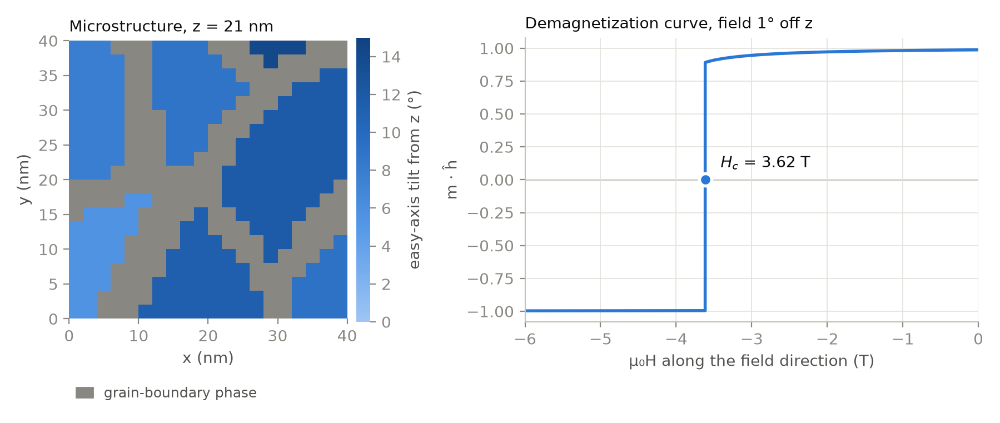

# micromag

[](https://github.com/tanooj-s/micromag/actions/workflows/tests.yml)
[](LICENSE)
[](pyproject.toml)

A finite-difference micromagnetic solver, written from scratch in C++ and CUDA and driven from Python.

<p align="center">
  <picture align="center">
    <source media="(prefers-color-scheme: dark)" srcset="docs/img/hero-dark.png">
    <source media="(prefers-color-scheme: light)" srcset="docs/img/hero-light.png">
    
  </picture>
</p>

<p align="center">
  <i>An 8-grain Nd₂Fe₁₄B polycrystal with a soft grain-boundary phase, run from <a href="examples/grains.toml"><code>examples/grains.toml</code></a> in about a minute on a laptop CPU.</i>
</p>

## Highlights

- Exchange, uniaxial anisotropy, Zeeman, and FFT demagnetization with the exact Newell tensor.
- Landau–Lifshitz–Gilbert dynamics with an adaptive Dormand–Prince RK45, and an energy minimizer with refined hysteresis sweeps.
- [A thermal field](docs/thermal.md): Brown's stochastic field, integrated by Heun or by adaptive RK23 with an exact Brownian bridge, with the same random numbers on the CPU and the GPU.
- [A CUDA backend](#gpu) in float64, with every kernel tested against the CPU implementation.
- [One TOML input card in, one results folder out](#input-cards): CSV tables, HDF5 states and full provenance.
- [Material regions on the MuMax3 model](#materials-regions-and-grains): painted shapes, 3D Voronoi grains with per-grain easy axes, an exact grain-boundary phase, and exchange coupling per region pair.
- [Validated](#validation) against µMAG standard problems 2, 3 and 4, published Nd₂Fe₁₄B results and the Stoner–Wohlfarth model.
- SI units throughout, and the dimensionless Gilbert α.
- A [Python API](#python-api) under the card, for scripting and testing.

micromag follows the micromagnetic model of the review by [Fischbacher et al. (2018)](https://doi.org/10.1088/1361-6463/aab7d1), and is modelled on the micromagnetic part of [MagTense](https://github.com/cmt-dtu-energy/MagTense). It is a teaching project in scientific-software architecture: every design decision is logged with its alternatives in [DECISIONS.md](DECISIONS.md).

## Installation

micromag builds from source with [uv](https://docs.astral.sh/uv/). You need a C++17 compiler; uv fetches Python, CMake and everything else.

```console
$ git clone https://github.com/tanooj-s/micromag.git
$ cd micromag
$ uv sync
```

To build the GPU backend, install the CUDA toolkit (12.x or 13.x; compute capability 7.0+) and set one variable:

```console
$ export SKBUILD_CMAKE_DEFINE="MICROMAG_CUDA=ON"
$ uv sync
```

See [docs/gpu.md](docs/gpu.md) for Colab, Slurm clusters and architecture flags.

> [!NOTE]
> On a Mac with Apple Silicon and an x86_64 `cmake` on `PATH`, `export ARCHFLAGS="-arch arm64"` first, or the extension builds for the wrong architecture.

## Quick start

```console
$ uv run micromag run examples/grains.toml -o runs/grains
stage 1/1 hysteresis: 64 fields, µ0H 0 → -6 T along [0.0175, 0.0, 0.9998], 22407 iterations; Hc -3.616 T, switching -3.616 T (71.8 s)
$ ls runs/grains
card.toml  provenance.json  stage1_hysteresis.csv  trajectory.h5  trajectory.xdmf
```

## Documentation

- [Input cards](docs/cards.md): every section and key, with units and defaults
- [The results folder](docs/results.md): the CSV columns, the HDF5 layout, provenance
- [Running on a GPU](docs/gpu.md): CUDA builds, Colab, Slurm
- [Thermal runs](docs/thermal.md): Brown's thermal field, the stochastic integrators, and their caveats
- [Verification](docs/verification.md): the test suite and the comparison with published results
- [Architecture](docs/architecture.md): how the pieces fit, the data layout, the file map

## Features

### Input cards

A card has a few setup sections, then stages that run in order. The magnetisation carries over from one stage to the next, and each stage states its own field. There are three stage types: `llg-dynamics`, `minimize` and `hysteresis`.

```toml
[grid]
n    = [128, 32, 1]
cell = [3.90625e-9, 3.90625e-9, 3e-9]   # m

[material.permalloy]
Ms = 8e5        # A/m
A  = 1.3e-11    # J/m

[initial]
m = [1, 1, 1]

[[stage]]       # relax to the S-state
type = "llg-dynamics"
alpha = 1.0
gamma = 1.759457895880903e11   # rad/(T·s), as µMAG specifies
until_torque = 1e-6
tol = 1e-9
check_every = 50e-12
max_duration = 20e-9

[[stage]]       # switch it: µMAG standard problem 4
type = "llg-dynamics"
alpha = 0.02
gamma = 1.759457895880903e11
mu0_H = [-24.6e-3, 4.3e-3, 0.0]   # T
duration = 1e-9
sample_every = 1e-12
```

Validation is strict: an unknown key, a missing key or a wrong type is reported, with every problem in the card listed together, before anything runs.

### Materials, regions and grains

Named materials are painted onto a per-cell region map: background first, then shapes in order. Voronoi grains with a coating phase fill any region.

```toml
[grains]
count    = 27
first_id = 1
material = "grain"
seed     = 1
axes     = { mean = [0, 0, 1], cone_deg = 15 }     # or "random"
boundary = { thickness = 4e-9, material = "boundary", id = 100 }

[[coupling]]                                        # or decouple grains without a boundary phase
regions = ["grains", "grains"]
scale   = 0.0
```

### GPU

The same card runs on either device:

```console
$ uv run micromag run examples/cube_core_shell.toml -o runs/cube --device cuda
```

### Python API

Everything a card does is also available from Python:

```python
import micromag as mm

# grid = mm.Grid(nx, ny, nz, dx, dy, dz); Ms, A, K per cell (nz, ny, nx); k and m (3, nz, ny, nx)
prob = mm.Problem(grid, Ms, A, K, k, H_ext=(0, 0, 0), device="cuda")
mm.Minimizer(prob).minimize(m)            # m: (3, nz, ny, nx), updated in place
mm.LLG(prob, alpha=0.02).run_until(m, 1e-9)
print(prob.energies(m))
```

## Validation

| Benchmark | micromag | Reference |
|---|---|---|
| µMAG SP3: single-domain cube edge | 8.4551 l_ex | 8.47 l_ex |
| µMAG SP4: first ⟨mx⟩ = 0 crossing | 138.6 ps | OOMMF: 138.4 ps |
| 40 nm Nd₂Fe₁₄B cube: switching field | 5.275 T | Fischbacher et al. 2017: 5.29 T |
| 255 decoupled grains: remanence, coercivity | 0.4705 M_s, 0.4627 H_K | Stoner–Wohlfarth for the same axes, agreeing to 10⁻⁷ |

The CPU and GPU give the same results. The full table, including µMAG SP2 and its one open discrepancy, is in [docs/verification.md](docs/verification.md).

## Contributing

```console
$ uv run pytest                 # fast suite, about 10 s
$ uv run pytest -m slow -s      # physics benchmarks, about 15 min on a CPU
```

The house rules, from [CLAUDE.md](CLAUDE.md):
- The CPU implementation is the oracle, and every GPU kernel is tested against it.
- Every numerical routine is tested against an analytic result or an independent oracle, and each test first fails against a stub.
- Every non-obvious decision gets an entry in [DECISIONS.md](DECISIONS.md).
- Card or output changes update [docs/](docs) in the same commit.

## FAQ

#### Is micromag ready for research use?

It is validated against the standard benchmarks above, but it is a young teaching code with a deliberately small feature set. It has uniaxial anisotropy only, free boundaries only, a single GPU, a thermal field without any cell-size correction, and no DMI or magnetoelastics. For production work, use [mumax3](https://mumax.github.io), [OOMMF](https://math.nist.gov/oommf/), [MagTense](https://github.com/cmt-dtu-energy/MagTense) or [Ubermag](https://ubermag.github.io).

#### Which GPUs does it support?

Any NVIDIA GPU of compute capability 7.0 or newer with CUDA 12, or 7.5 or newer with CUDA 13. All arithmetic is float64, so data-centre cards (V100, A100, H100) are far faster than consumer cards.

#### How does it relate to MagTense, mumax3 and OOMMF?

It is a new implementation, not a fork. Its scope follows MagTense's micromagnetic solver, its region model follows mumax3, and OOMMF's published results are among its references.

## Acknowledgements

- The physics follows T. Fischbacher et al., *J. Phys. D* **51**, 193002 (2018). The Nd₂Fe₁₄B benchmarks are from Fischbacher et al., *APL* **111**, 072404 (2017).
- The standard problems are [µMAG](https://www.ctcms.nist.gov/~rdm/mumag.org.html)'s, and the reference results are by the OOMMF and MagTense developers.
- The region and coupling model follows [mumax3](https://mumax.github.io).
- Built on [nanobind](https://github.com/wjakob/nanobind), [pocketfft](https://github.com/mreineck/pocketfft), [scikit-build-core](https://github.com/scikit-build/scikit-build-core) and [uv](https://github.com/astral-sh/uv). This README is modelled on uv's.

## License

micromag is licensed under the [GNU General Public License v3.0 or later](LICENSE).
